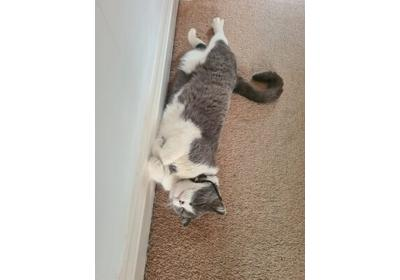
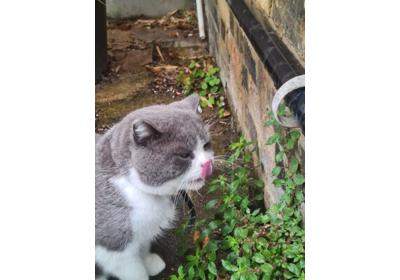
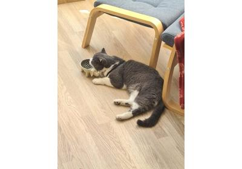

# Decoding: low-level APIs

[Build your own decoding pipeline](basics.html)

Build your own decoding pipeline

[Multi-threaded decoding pipelines](pipelines.html)

Multi-threaded decoding pipelines

[Raw frames and raw audio samples](raw_data.html)

Raw frames and raw audio samples

[Decoding packets that don't come from a Demuxer](demuxer_free.html)

Decoding packets that don't come from a Demuxer

[Low-level APIs and CUDA streams synchronization](cuda_streams.html)

Low-level APIs and CUDA streams synchronization